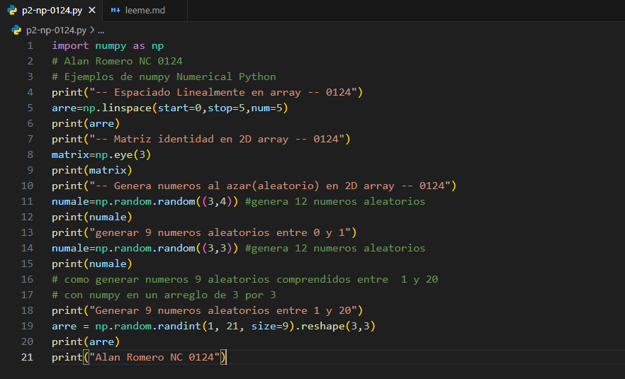
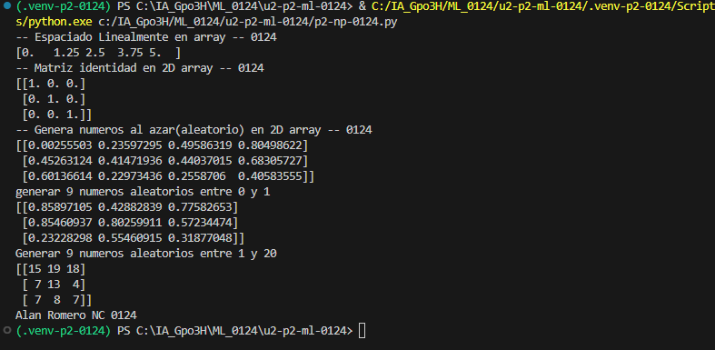

-start=0: indica el valor inicial de la secuencia, que es 0.

-stop=1: indica el valor final de la secuencia, que es 1. Por defecto, este valor se incluye.

-num=5: indica la cantidad de números que se generarán; en este caso, serán 5.
espaciados dentro de un intervalo.

## que es np.linspace
es una función de NumPy que genera una cantidad determinada de números igualmente espaciados entre un valor inicial y uno final.

## El codigo 

## Resultado

